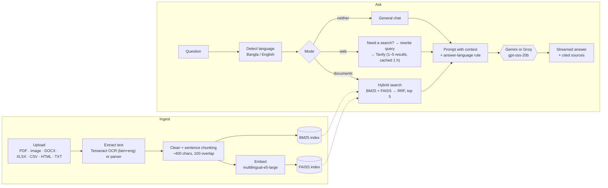

# Multimodal RAG System

A bilingual (**Bangla and English**) retrieval-augmented chatbot. Upload PDFs, scanned pages, Office files or photos of text, then ask questions about them. Answers come with page-level citations, in the same language as the question. With no documents loaded, it can search the web instead.

Built with **FastAPI** (backend) and **Streamlit** (UI), using **FAISS + BM25 hybrid retrieval**, **Tesseract OCR** and either **Gemini** or **Groq** (`openai/gpt-oss-20b`) as the language model.

## What it does

- **Reads almost any document.** PDFs and images go through OCR (Bangla + English), so scanned and photographed pages work too. Word, Excel, CSV, HTML, Markdown and plain text are parsed directly. Tables found in OCR output are turned into Markdown so their structure survives.
- **Hybrid retrieval.** Each question is matched two ways, by keywords (BM25) and by meaning (multilingual `intfloat/multilingual-e5-large` embeddings in FAISS), and the two rankings are merged with **reciprocal rank fusion**. This catches both exact terms and paraphrases.
- **Answers in the user's language,** with citations to the document and page each passage came from. If the documents don't contain the answer, it says so rather than guessing.
- **Web search when needed.** In web mode the model first decides whether the question needs fresh information at all. If it does, it rewrites the conversation into a focused search query, picks how many results to fetch (1–5) and searches with Tavily. Results are cached for an hour and reused when a follow-up question is still covered.
- **Per-session document stores.** Each chat session has its own index, so documents from different sessions never mix. Documents can be added and removed individually, and duplicates are skipped.
- **Streaming answers** from either Gemini or Groq, selectable in the sidebar.

## How it works



## Supported files

| Type | How it's read |
|---|---|
| `.pdf` | Rendered at 300 DPI and OCR'd page by page in parallel (Bangla + English) |
| `.png` `.jpg` `.jpeg` `.tiff` `.bmp` | Converted to black and white, then OCR'd (Bangla + English) |
| `.docx` | Paragraphs, plus tables as Markdown rows, via `python-docx` |
| `.xlsx` `.csv` | Loaded with pandas, with an inferred SQL-style schema so the model understands the columns |
| `.html` | Visible text plus tables as Markdown rows, via BeautifulSoup |
| `.txt` `.md` | As-is (tries several encodings) |

## Getting started

### Prerequisites

- Python 3.10+
- [Tesseract OCR](https://github.com/tesseract-ocr/tesseract) with the **Bengali (`ben`)** and **English (`eng`)** language packs
- [Poppler](https://poppler.freedesktop.org/), needed by `pdf2image` to render PDF pages

On Windows the app also looks for Tesseract in `C:\Program Files\Tesseract-OCR` and Poppler in `C:\Program Files\poppler-24.08.0\Library\bin`.

### Install

```bash
git clone https://github.com/a1if/multimodal-rag-system.git
cd multimodal-rag-system
python -m venv venv
source venv/bin/activate        # Windows: venv\Scripts\activate
pip install -r requirements.txt
```

### Configure

Create a `.env` file in the project root:

```
GEMINI_API_KEY=your_gemini_key
GROQ_API_KEY=your_groq_key        # optional: enables the Groq model
TAVILY_API_KEY=your_tavily_key    # optional: enables web search
BACKEND_HOST=0.0.0.0
BACKEND_PORT=8000
```

At least one of `GEMINI_API_KEY` or `GROQ_API_KEY` is required.

### Run

```bash
python start_services.py
```

This starts the FastAPI backend and the Streamlit UI on free ports and prints both URLs. Open the UI, upload documents from the sidebar and start asking questions.

## API

| Method | Endpoint | Purpose |
|---|---|---|
| `GET` | `/status` | Health check |
| `POST` | `/upload` | Upload one or more documents into a session |
| `GET` | `/documents` | List the documents loaded in a session |
| `POST` | `/delete_document` | Remove one document from a session |
| `POST` | `/rag` | Ask a question. Streams the answer, then the sources |
| `POST` | `/clear_history` | Clear a session's chat history |

## Project structure

```
app/
  main.py              FastAPI app and startup checks
  api.py               HTTP endpoints
  pipeline.py          Retrieval, web-search routing, prompting and generation
  document_loader.py   Text extraction and OCR for every file type
  vector_store.py      Per-session FAISS index and chunk storage
  web_search.py        Tavily search
  utils.py             Text cleaning, sentence chunking, MMR selection
frontend/
  streamlit_app.py     Chat UI
start_services.py      Launches backend + frontend on free ports
```

## Notes and limitations

- Sessions are stored on local disk under `vectorstore/`. This is meant for running locally, not as a multi-user service.
- Language detection and the web-search decisions are made by the selected LLM, so each question costs a few small extra model calls.
- OCR quality depends on the scan. Low-resolution photos of text will give weaker answers.
